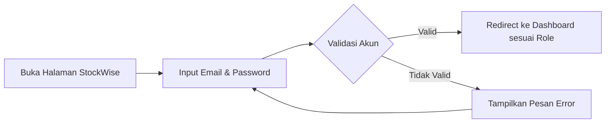
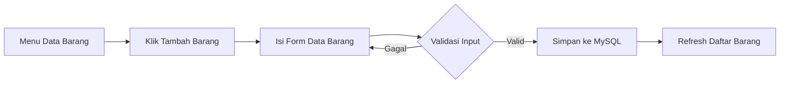
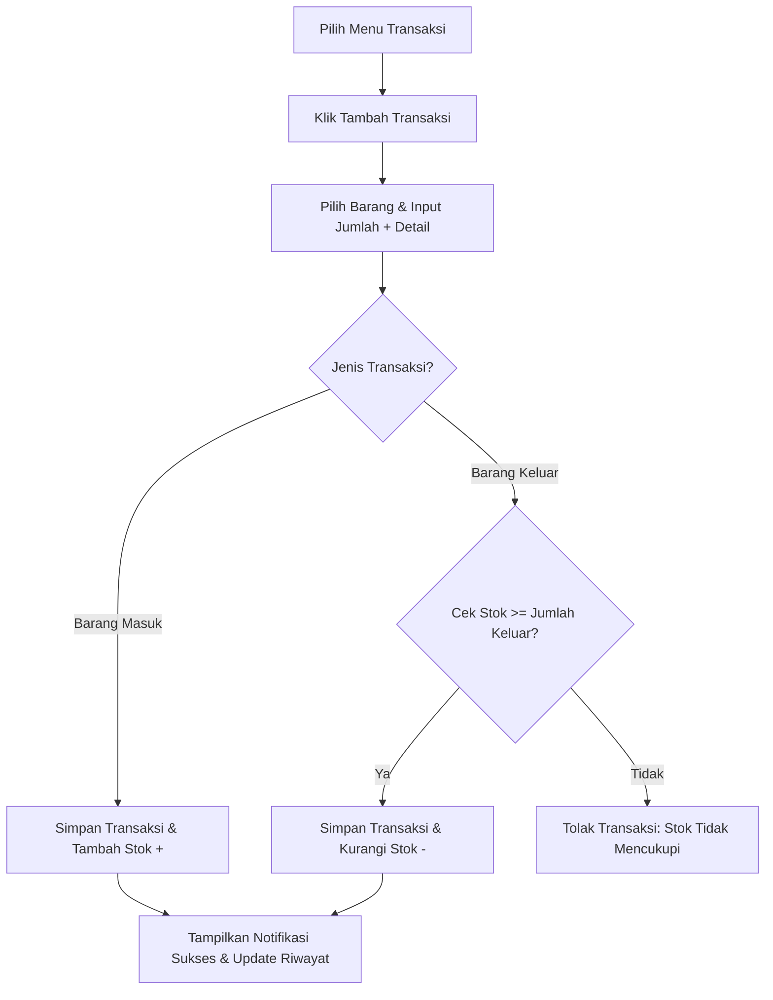
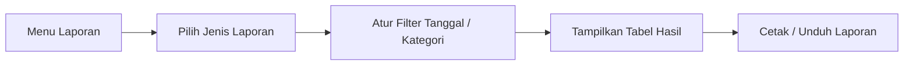

# 📦 PRODUCT REQUIREMENTS DOCUMENT (PRD)
## **StockWise** — Sistem Informasi Manajemen Inventaris Gudang Distribusi

| Atribut Proyek | Detail Spesifikasi |
| :--- | :--- |
| **Nama Aplikasi** | **StockWise** |
| **Judul Proyek** | Sistem Informasi Manajemen Inventaris Gudang Distribusi |
| **Platform** | Web Application (Responsive Desktop, Tablet, & Mobile) |
| **Versi & Status** | `v1.0` — 🟡 **Draft** |
| **Tech Stack** | **Backend:** Laravel • **Frontend:** Vue.js • **Bridge:** Inertia.js • **DB:** MySQL |
| **Tujuan Dokumen** | Pedoman utama pengembangan & *Single Source of Truth* (Context) untuk **AI Coding Tools** |

---

## 1. Latar Belakang & Permasalahan

### 1.1 Latar Belakang
Gudang distribusi memegang peran vital dalam rantai penyimpanan dan penyaluran barang, mencakup pencatatan barang masuk/keluar, pemantauan stok, serta pengelolaan pemasok. Ketika proses ini masih dilakukan secara manual atau tersebar di dokumen terpisah, risiko ketidaksesuaian stok, keterlambatan pencarian data, dan lamanya rekapitulasi laporan meningkat tajam.

**StockWise** hadir sebagai sistem informasi berbasis web yang memusatkan seluruh aktivitas inventaris gudang dalam satu platform yang akurat, *real-time*, dan mudah diaudit.

### 1.2 Matriks Permasalahan & Solusi
| No | Permasalahan Operasional | Solusi di StockWise |
| :---: | :--- | :--- |
| **1** | Data barang & persediaan tersebar di banyak dokumen | Sentralisasi database barang, kategori, dan stok dalam satu sistem |
| **2** | Risiko *human error* & keterlambatan catat transaksi | Formulir transaksi tervalidasi dengan pembaruan stok otomatis |
| **3** | Sulit memantau jumlah stok terkini secara cepat | Dashboard ringkasan & halaman persediaan *real-time* |
| **4** | Data supplier & riwayat transaksi tidak terstruktur | Modul manajemen supplier & log riwayat transaksi historis |
| **5** | Tidak ada peringatan dini saat stok menipis | Indikator status & daftar pantauan **Batas Stok Minimum** |
| **6** | Rekapitulasi laporan memakan waktu lama | Generator laporan otomatis dengan filter periode & fitur cetak/unduh |

---

## 2. Tujuan & Deskripsi Aplikasi

### 2.1 Deskripsi Aplikasi
**StockWise** adalah aplikasi manajemen inventaris berbasis web yang dibangun menggunakan arsitektur monolitik modern (**Laravel + Inertia.js + Vue.js + MySQL**). Sistem ini menerapkan logika mutasi stok otomatis:
* 📥 **Transaksi Barang Masuk** $\rightarrow$ Menambah jumlah stok barang secara otomatis setelah disimpan.
* 📤 **Transaksi Barang Keluar** $\rightarrow$ Memvalidasi ketersediaan stok terlebih dahulu (mencegah stok minus), lalu mengurangi jumlah stok secara otomatis.

### 2.2 Tujuan Pengembangan
1. Memusatkan pengelolaan master data barang, kategori, dan supplier.
2. Menyederhanakan dan mengamankan pencatatan transaksi barang masuk serta barang keluar.
3. Menyediakan visibilitas stok terkini beserta peringatan dini untuk barang di bawah batas minimum.
4. Menyajikan jejak audit (*audit trail*) riwayat transaksi dan mempermudah pembuatan laporan inventaris.

---

## 3. Target Pengguna & Hak Akses (RBAC)

Sistem membatasi akses berdasarkan peran (*Role-Based Access Control*) yang dikelola oleh Administrator:

### 3.1 Profil Pengguna
* 👨‍💼 **Administrator:** Bertanggung jawab atas tata kelola master data, manajemen akun pengguna, pengawasan stok, dan pelaporan manajerial.
* 👷 **Petugas Gudang:** Bertanggung jawab atas operasional harian di lapangan, khususnya pencatatan transaksi barang masuk/keluar dan pengecekan stok fisik.

### 3.2 Matriks Hak Akses Fitur
| Modul / Fitur | Administrator | Petugas Gudang |
| :--- | :---: | :---: |
| **Dashboard & Ringkasan Inventaris** | ✅ Penuh | ✅ Sesuai Hak Akses |
| **Manajemen Akun Pengguna** | ✅ CRUD | ❌ Tidak Ada Akses |
| **Master Data Barang & Kategori** | ✅ CRUD | 👁️ Lihat Saja (Read) |
| **Master Data Supplier** | ✅ CRUD | 👁️ Lihat (Saat Transaksi) |
| **Transaksi Barang Masuk** | ✅ Lihat & Kelola | ✅ Catat & Lihat Riwayat |
| **Transaksi Barang Keluar** | ✅ Lihat & Kelola | ✅ Catat & Lihat Riwayat |
| **Pemantauan Persediaan & Stok Minimum** | ✅ Penuh | ✅ Penuh |
| **Laporan Inventaris (Cetak / Unduh)** | ✅ Penuh | ❌ Tidak Ada Akses |

---

## 4. Identifikasi Kebutuhan & Fitur Utama

### 🔐 4.1 Autentikasi & Manajemen Akun
* Login menggunakan `email` dan `password` terenkripsi, serta fitur Logout.
* Pemisahan sesi dan otorisasi rute berdasarkan peran (`Administrator` vs `Petugas Gudang`).
* Pengelolaan akun pengguna (tambah, ubah, nonaktifkan/hapus) oleh Administrator.

### 📊 4.2 Dashboard Inventaris
* **KPI Cards:** Total jenis barang, total keseluruhan stok, jumlah transaksi masuk, dan jumlah transaksi keluar.
* **Peringatan Stok:** Daftar barang yang menyentuh atau berada di bawah batas stok minimum.
* **Visualisasi & Log:** Grafik aktivitas barang masuk vs keluar, serta tabel transaksi terbaru.

### 📦 4.3 Manajemen Data Barang & Kategori
* **CRUD Data Barang:** Mencakup `Kode Barang`, `Nama Barang`, `Kategori`, `Satuan`, `Jumlah Stok`, `Batas Stok Minimum`, dan `Deskripsi` (opsional).
* **CRUD Kategori:** Pengelompokan barang dengan proteksi relasi (kategori tidak dapat dihapus jika masih terhubung dengan data barang).
* **Pencarian & Filter:** Pencarian cepat berdasarkan nama/kode serta penyaringan berdasarkan kategori.

### 🚚 4.4 Manajemen Supplier
* **CRUD Data Pemasok:** Mencakup `Nama Supplier`, `Nama Kontak` (opsional), `Nomor Telepon`, `Email` (opsional), dan `Alamat`.
* Dilengkapi fitur pencarian dan tampilan detail pemasok.

### 📥 4.5 Transaksi Barang Masuk
* Pencatatan penerimaan barang: pilih `Barang`, input `Jumlah`, pilih `Supplier` (opsional), `Tanggal Penerimaan`, dan `Catatan` (opsional).
* **Aturan Sistem:** Setelah validasi berhasil, stok barang terkait otomatis bertambah.

### 📤 4.6 Transaksi Barang Keluar
* Pencatatan distribusi barang: pilih `Barang`, input `Jumlah`, isi `Tujuan Distribusi / Penerima`, `Tanggal Pengeluaran`, dan `Catatan` (opsional).
* **Aturan Sistem (Validasi Ketat):** Sistem wajib mengecek sisa stok sebelum menyimpan. Jika `Jumlah Keluar > Stok Tersedia`, transaksi **ditolak** dengan pesan peringatan. Jika valid, stok otomatis berkurang.

### 📋 4.7 Manajemen Persediaan (Stok)
* Tampilan status seluruh barang dengan indikator visual (misal: *Aman* vs *Stok Minimum / Menipis*).
* Pencarian, filter status stok, dan penelusuran riwayat mutasi per barang.

### 📑 4.8 Laporan Inventaris
* Menyajikan 3 jenis laporan utama: **Laporan Stok Barang**, **Laporan Barang Masuk**, dan **Laporan Barang Keluar**.
* Filter berdasarkan **rentang tanggal**, **barang**, atau **kategori**, dilengkapi tombol **Cetak / Unduh**.

---

## 5. User Flow (Alur Penggunaan Aplikasi)

### 5.1 Alur Autentikasi (Login)

### 5.2 Alur Pengelolaan Data Barang (Admin)

### 5.3 Alur Transaksi Barang Masuk & Keluar (Petugas Gudang)

### 5.4 Alur Pembuatan Laporan (Admin)

---

## 6. Spesifikasi Kebutuhan Sistem

### 6.1 Kebutuhan Fungsional (Functional Requirements)
| ID | Kategori | Spesifikasi Kebutuhan Fungsional |
| :--- | :--- | :--- |
| **FR-01** | Autentikasi | Sistem menyediakan fitur login dan logout yang aman. |
| **FR-02** | Otorisasi | Sistem membedakan hak akses antara Administrator dan Petugas Gudang. |
| **FR-03** | Akun | Administrator dapat mengelola (tambah, ubah, hapus) akun pengguna. |
| **FR-04** | Dashboard | Sistem menampilkan ringkasan statistik inventaris, grafik, dan peringatan stok minimum. |
| **FR-05** | Master Data | Pengguna berwenang dapat mengelola data barang (CRUD). |
| **FR-06** | Master Data | Pengguna berwenang dapat mengelola kategori barang (CRUD). |
| **FR-07** | Master Data | Pengguna berwenang dapat mengelola data supplier (CRUD). |
| **FR-08** | Transaksi | Petugas berwenang dapat mencatat transaksi barang masuk. |
| **FR-09** | Transaksi | Petugas berwenang dapat mencatat transaksi barang keluar. |
| **FR-10** | Logika Stok | Sistem otomatis menambah jumlah stok setelah transaksi barang masuk tersimpan. |
| **FR-11** | Logika Stok | Sistem otomatis mengurangi jumlah stok setelah transaksi barang keluar tersimpan. |
| **FR-12** | Validasi Stok | Sistem menolak penyimpanan transaksi barang keluar jika jumlah melebihi stok tersedia. |
| **FR-13** | Persediaan | Sistem menampilkan informasi jumlah persediaan terkini untuk setiap barang. |
| **FR-14** | Peringatan | Sistem menandai secara visual barang yang stoknya mencapai atau di bawah batas minimum. |
| **FR-15** | Riwayat | Sistem menyimpan dan menampilkan riwayat transaksi secara kronologis. |
| **FR-16** | Pelaporan | Sistem menyediakan laporan stok, laporan barang masuk, dan laporan barang keluar. |
| **FR-17** | Pencarian | Sistem menyediakan fitur pencarian dan penyaringan (*filter*) pada data & laporan. |
| **FR-18** | Ekspor | Sistem menyediakan fasilitas cetak (*print*) atau unduh (*export*) laporan. |

### 6.2 Kebutuhan Nonfungsional (Non-Functional Requirements)
| Aspek | Parameter & Standar Kualitas |
| :--- | :--- |
| **🔒 Keamanan** | • Autentikasi wajib untuk seluruh halaman internal. • Enkripsi password menggunakan *hashing* (Bcrypt/Argon2 bawaan Laravel). • Validasi input sisi server (*Form Request*) dan pembatasan akses berbasis *Middleware/Policy*. |
| **🎨 Kemudahan Penggunaan** | • Antarmuka bersih, konsisten, dan navigasi sidebar persisten. • Label formulir jelas dengan umpan balik notifikasi (*toast/alert*) untuk setiap aksi berhasil/gagal. |
| **⚡ Kinerja** | • Waktu muat halaman dan kueri pencarian/filter berjalan cepat dan responsif. • Pembacaan data dioptimalkan sesuai kebutuhan halaman (*pagination* & *eager loading*). |
| **🌐 Kompatibilitas** | • Berjalan optimal pada browser modern (Google Chrome, Microsoft Edge, Mozilla Firefox). • Desain *responsive* yang menyesuaikan layar desktop, tablet, dan mobile browser. |
| **🛡️ Keandalan Data** | • Menggunakan *Database Transaction* (`DB::transaction`) saat menyimpan transaksi dan mengubah stok agar data tetap konsisten. • Menjamin nilai stok tidak pernah bernilai negatif (`< 0`). |

---

## 7. Gambaran Awal Antarmuka (UI Wireframe Concept)

Aplikasi mengusung konsep **Modern Admin Dashboard** dengan tata letak **Sidebar Navigasi (Kiri)**, **Top Header (Info Akun & Logout)**, serta **Area Konten Utama** yang bersih dan responsif.

| Halaman | Elemen & Komponen Utama Antarmuka |
| :--- | :--- |
| **1. Halaman Login** | Card terpusat dengan logo **StockWise**, input `Email`, input `Password`, tombol `Masuk`, dan pesan validasi error. |
| **2. Dashboard** | 4 Kartu ringkasan statistik (Total Barang, Total Stok, Masuk, Keluar), Grafik aktivitas inventaris, Tabel peringatan stok minimum, & Tabel transaksi terbaru. |
| **3. Data Barang** | Header halaman + tombol `+ Tambah Barang`, Search bar, Dropdown filter kategori, Tabel data (`Kode`, `Nama`, `Kategori`, `Stok`, `Satuan`, `Status`, `Aksi`). |
| **4. Kategori Barang** | Search bar, tombol `+ Tambah Kategori`, dan Tabel daftar kategori beserta tombol aksi `Edit` & `Hapus`. |
| **5. Supplier** | Search bar, tombol `+ Tambah Supplier`, dan Tabel data pemasok (`Nama`, `Kontak`, `Telepon`, `Email`, `Alamat`, `Aksi`). |
| **6. Barang Masuk** | Tombol `+ Catat Barang Masuk`, Form input (Barang, Supplier, Jumlah, Tanggal, Catatan), dan Tabel riwayat barang masuk. |
| **7. Barang Keluar** | Tombol `+ Catat Barang Keluar`, Form input dengan indikator **Sisa Stok Tersedia**, Tujuan/Penerima, Tanggal, dan Tabel riwayat barang keluar. |
| **8. Persediaan** | Search bar & filter status stok, Tabel seluruh persediaan dengan badge status warna (`Aman` / `Stok Menipis`) & modal/halaman riwayat mutasi stok. |
| **9. Laporan** | Panel filter (Jenis Laporan, Rentang Tanggal, Barang/Kategori), Tombol `Tampilkan`, `Cetak`, & `Unduh`, serta Tabel pratinjau laporan. |

---

## 8. Batasan & Ruang Lingkup Proyek

* **Dalam Ruang Lingkup (*In-Scope*):** Aplikasi berbasis web (Laravel, Vue.js, Inertia.js, MySQL) untuk pengelolaan inventaris satu gudang utama, mencakup master data (barang, kategori, supplier), transaksi masuk/keluar, pemantauan stok minimum, dan laporan.
* **Di Luar Ruang Lingkup (*Out-of-Scope*):** Integrasi API pihak ketiga dengan jasa ekspedisi, fitur *payment gateway* / pembayaran online, manajemen multi-gudang (*multi-warehouse*), dan aplikasi mobile *native* (Android/iOS).

---

## 9. Pedoman Pemanfaatan AI Coding Tools

Dokumen `PRD.md` ini berfungsi sebagai **konteks utama (*grounding*)** selama proses pengembangan menggunakan AI Coding Tools.

1. **Acuan Prompting:** Setiap instruksi pembuatan struktur folder Laravel/Vue, migrasi database MySQL, *controller*, hingga komponen UI harus merujuk pada spesifikasi dan kode kebutuhan (`FR-01` s.d. `FR-18`) dalam dokumen ini.
2. **Kebutuhan Dasar yang Dibantu AI:** Perancangan skema relasi database, pembuatan komponen antarmuka Vue + Inertia, implementasi logika transaksi & validasi stok, *debugging*, serta penyusunan skenario pengujian.
3. **Verifikasi & Sinkronisasi:** Seluruh kode hasil generasi AI wajib ditinjau dan diuji sebelum digabungkan. Apabila terjadi penyesuaian fitur selama pengembangan, dokumen `PRD.md` ini harus segera diperbarui agar tetap konsisten.